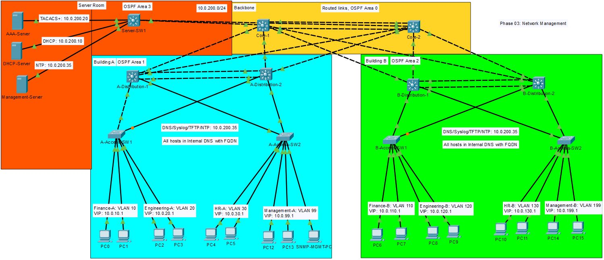

## TNARC HQ: Network Managment, Monitoring and DNS

## The problem
Stage 2 hardening added AAA logins and security controls, but every event stays on the device that logged it. No one sees a rogue DHCP block or a failed login unless they're on that switch. Events on different devices can't be lined up. Additionally there are no configuration backup, a failed switch would mean rebuilding from memory. Users and admins reach everything by IP address, with no internal name resolution. Leadership wants these shared services in place before any new site is connected.

## Requirements
1. Every device's clock is synchronized from one trusted source.
2. Logs from every device reach a central server, with timestamps lined up.
3. Device statistics can be read remotely (read only), and only from approved hosts.
4. Every configuration is backed up centrally, and a restore has been tested.
5. Internal DNS resolves server and network devices by name, DHCP clients get DNS server automatically.
6. Security events (port security, BPDU Guard, AAA failures) appear in central logs.

## Topology changes
| Device | Port | | Device | Port | Subnet | Change | 
|--------|------|-|--------|------|--------|--------|
| Management-Server | fa0 | -> | Server-SW1 | g1/0/5 | 10.0.200.32/28 | Added |
| AAA-Server | fa0 | -> | Server-SW1 | g1/0/4 | 10.0.200.16/28 | Subnet from 10.0.201.0/24 to 10.0.200.16/28 |
| DHCP-Server | fa0 | -> | Server-SW1 | g1/0/3 | 10.0.200.0/28 | Subnet from /24 to /28 |

## Key decisions
1. Decided to reduce the AAA server subnet to a /28 and combine it with the DHCP network. This is to waste less host addresses within the network and to help keep a clean direction for the server addresses.

2. NTP service was configured on the Management-Server using 10.0.200.35 as the IP address and CST timezone.

3. Syslog configured on the Management-Server on IP address: 10.0.200.35, it was configured to debugging trap level, timestamps enabled and all switches are synched with NTP.

4. Internal Domain Name System (DNS) configured with all devices, excluding hosts, added with their loopback addresses. Name server IP was added to the DHCP server, next time a host renews their IP lease the DNS will be included. 

## Verification
| Requirement | Service | Result | Evidence |
|-------------|---------|--------|----------|
| 1 | Network Time Protocol (NTP) | Success | [NTP](./Verification/verification.md#ntp) |
| 2 | Syslog | Success | [Syslog](./Verification/verification.md#syslog) |
| 3 | Snmp | Failed | [SNMP](./Verification/verification.md#snmp) |
| 4 | TFTP | Success | [TFTP](./Verification/verification.md#tftp) |
| 5 | DNS | Success | [DNS](./Verification/verification.md#dns)
| 6 | Syslog | Success | [Security Alerts](./Verification/verification.md#security-alerts-on-syslog) |

## Challenges and fixes
1. I realized it was a mistake to make the DHCP server into the 10.0.200.0/24 subnet so I switched it to 10.0.200.0/28, this allowed me to change the AAA-Server from 10.0.201.0/24 to 10.0.200.16/28. The mistake was a short sight and should have been avoided from the beginning, however it is best to fix it now.

2. Cisco Packet Tracer lacks clock commands support so I had rely definitively on the Server NTP service and network synching together. This at the very least gave me equal timing across the network.

3. Requirement 3 could not be properly executed because of Cisco Packet Tracer's lack of proper SNMP support. Firstly, I could not setup the community string to be specific to the ACL that was being configured. So instead of "snmp-server community TNARCsnmp ro SNMP-HOSTS" I would have to settle for "snmp-server community TNARCsnmp ro". Secondly, CPT would not allow contact nor location information to be set up. For now I have chosen to accept the risk for requirement 3 until development of CPT allows better configuration.

## Limitations
- Packet Tracer does not offer enough "clock" and very limited support for "calander" setup, I was able to use the centralized NTP server but All device could not have their clocks updated nor synced. All devices will still be in sync for alerts and events but within the devices themselves time will be inaccurate and unsynced. 

- Packet Tracer’s SNMP support is too limited to demonstrate restricted, read-only polling. In production, every device would run SNMPv3 with authentication and encryption (authPriv), using read-only views, and only accept queries from the monitoring server (an ACL tied to the SNMP group). The monitoring server would also receive traps for events such as link failures.

## What I'd do next
1. Multi-site WAN with dynamic routing for any branches that need connection to HQ.
2. NOC and Network Management.
3. Enterprise Wireless.