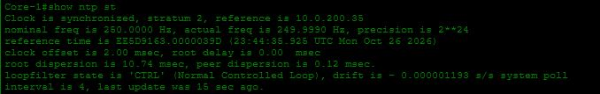
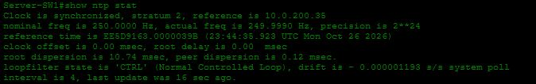
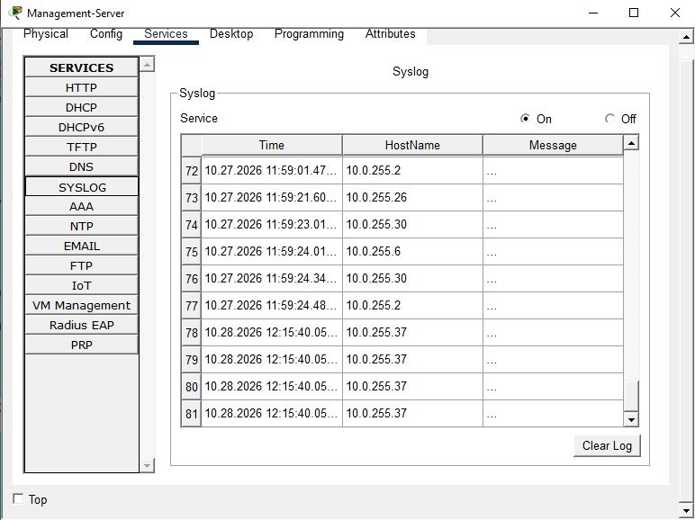
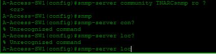
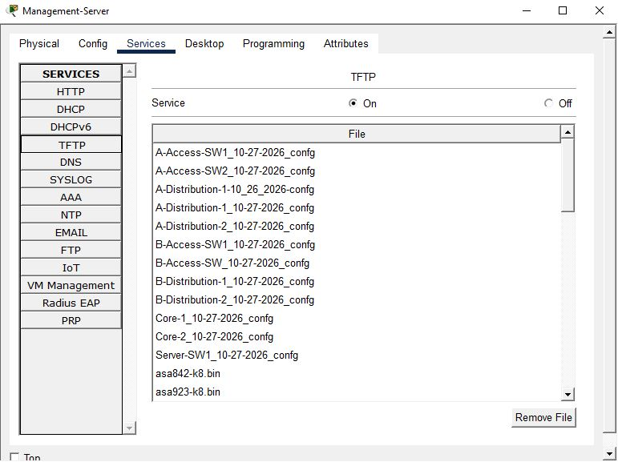
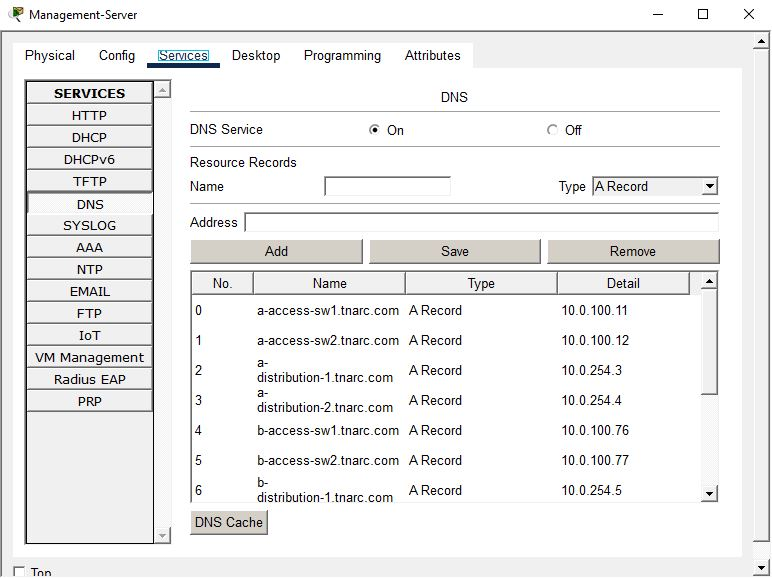
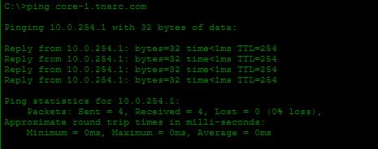
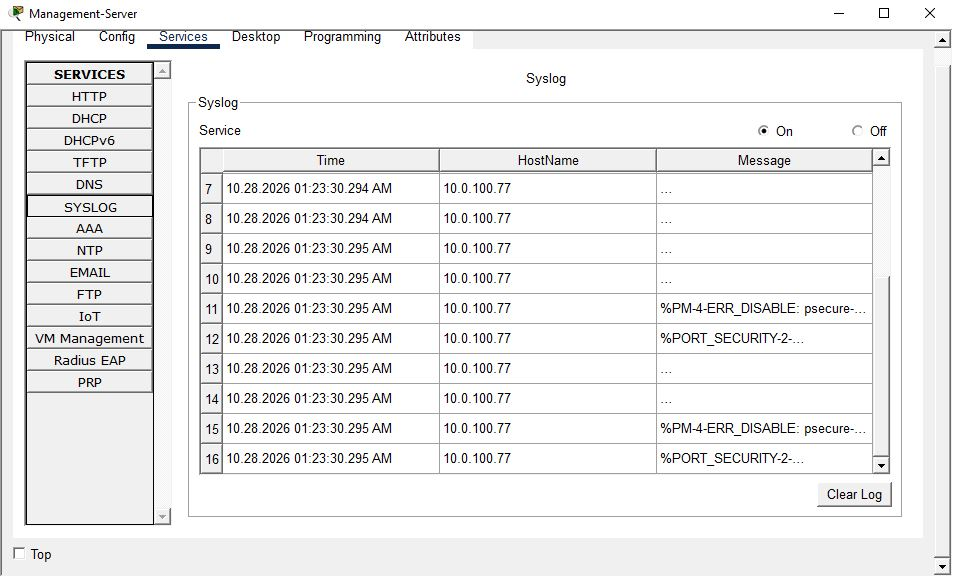

## NTP 
##### Device 1

##### Device 2

## Syslog
#### Cisco Service Page

## SNMP 
#### Cisco Syslog Page

Here we can see that an ACL after the community string command line is not supported. Additionally, no command for location or contact is recognized on Layer 2 and 3 switches.

## TFTP
#### Configs for all switches backed up to TFTP on the Management-Server

## DNS

#### DNS Host

#### Ping from PC0 using domain name instead of IP

## Security Alerts on Syslog
